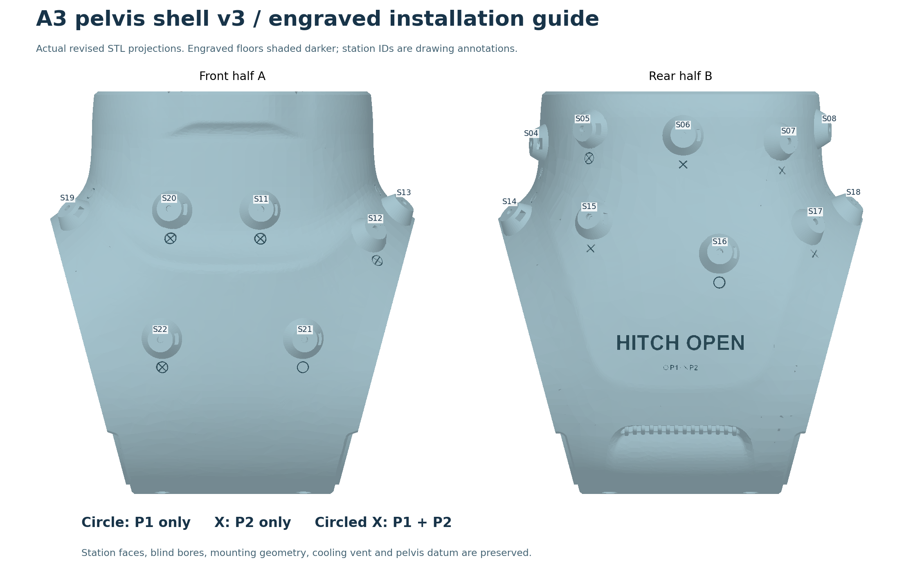

# A3 dual-mode marker shell v3

**2026-11-01: engraved v3 shell with the same 17 stations and P1/P2 marker coordinates.**
The rear half carries HITCH OPEN and a second line, **○ P1 · X P2**, above the cooling vent and below the marker stations.
Every station has a nearby recessed installation symbol: circle for P1 only,
X for P2 only, and circled X for shared P1/P2 stations. The flat optical seats
are untouched. Both halves are revised; the flush pin is unchanged.

Printable mesh geometry is checked; physical fit, retention, tracking and crash
testing remain required. The v3 name and printable filenames are unchanged.
The unengraved masters came from
[HOPE commit 10b1bd710c074cf9851a3ca2f63494dc23a39e06](https://github.com/hitchopen/HOPE/commit/10b1bd710c074cf9851a3ca2f63494dc23a39e06).
The revised manufacturing masters use the unengraved baseline at commit
c3ddf258; baseline identities and final checks are recorded in the validation files.
Coordinate tables, workbook, optical import files and runtime profiles retain
their previous bytes; the STL hashes and manufacturing provenance are updated.

The default localization mode remains **`motive_live`**: it uses the selected
body's current NatNet ModelDef without binding to a file SHA-256, marker count
or reference layout. A fresh calibration JSON is not required by that mode.
The marker monitor derives its expected count from the current definition.

For **ChingMu / CMTracker over VRPN**, use [P1.json](vrpn_asset/P1.json) or
[P2.json](vrpn_asset/P2.json) with the corresponding installation below.
Both preserve nominal `pelvis_link` and ROS axes; neither uses Motive's Y-up
mapping. Their internal names are `UCB_P1` and `UCB_P2` for HOPE routing.
The updated **V4** runtime profile carries the two different 12-marker definitions;
the CAD folder remains v3. VRPN has no live ModelDef. Matching
[OptiTrack P1/P2 assets](motive_asset/README.md) now use the same selected points
with Motive's native unit/axis encoding.

## Engraved installation symbols

| Engraving | Use | Stations |
|---|---|---|
| Circle (○) | P1 only | S13, S14, S16, S19, S21 |
| X | P2 only | S06, S07, S08, S15, S17 |
| Circled X (⊗) | P1 and P2 | S04, S05, S11, S12, S18, S20, S22 |

Symbols are engraved in the exterior skin beside the 20 mm mount feet, not in
the 12 mm sticker faces. Most sit below a mount; S13/S14/S18/S19 sit above
their mounts to avoid thin side-edge regions. Symbols are 6 mm across with
0.7 mm strokes, recessed 0.4 mm along the local engraving axis.
The rear wordmark uses Arial Bold, approximately 60.94 × 7.50 mm and 0.60 mm
deep; its top points toward the upper shell edge. It lies at CAD Y=-15.75 to
-8.25 mm, above the cooling vent and below the rear stations.
A second engraved line, **○ P1 · X P2**, is centred below the wordmark at
CAD Y=-24 mm. It is approximately **16.57 × 2.50 mm** and **0.40 mm** deep;
Its circle, separator dot and X are explicit geometric shapes, with 0.35 mm
legend-symbol grooves. The 7.50 mm trademark remains visually dominant.
The legend's top is 7.00 mm below the wordmark's bottom edge; the cooling vent remains clear.
The smallest sampled remaining wall under this line is **2.112 mm**.



The marks identify where to apply each player's 12 reflective stickers; they
do not change the optical pattern or make shared-only observations unique.
Keep all unused stations and engraving nonreflective. See the
[engraving checks](documents/engraving_validation.json).

## Preserved layout and previous restoration

- All ten obsolete external marker bosses **and their screw bores** are removed,
  including f1 and b1-b5. Their locations are restored to smooth local shell skin.
- Stations **S01, S02, S03, S09, S10, S23, S24** remain removed,
  including their mounting holes; these locations retain the smooth
  base-shell skin. No holes were cut through the pelvis-fitting interior.
- The **front seven are unchanged: S11, S12, S13, S19, S20, S21, S22**.
  The engraving changes adjacent exterior skin; all seven front mounts are protected.
- Restored **S06, S07, S08, S15, S17**, completing rear upper row
  **S04-S08** and rear middle row **S14-S18** (five each). These are the
  original asymmetric station locations, not newly regularized rings.
  Original station IDs are preserved, not renumbered.
- All 17 asymmetric stations have **flat 12 mm tops**, with no raised rims or
  recessed sticker pockets. Each retains its **3.4 mm central blind screw bore**
  and side-access captive-nut pocket; these are not through-holes.
- Structural shell fastener holes, seams and surrounding ribs are retained.
  Upper internal reliefs remain; only the old cavities near the restored skin
  are filled. Small, measured mesh cleanup was also needed.
- The previous 12 marker positions and axes are unchanged. The `pelvis_link`
  tables add the five restored stations from the archived CAD definitions;
  neither the pelvis datum nor the seven front marker coordinates moved.

## Printable files

| File | Use |
|---|---|
| [Half A](printable/a3_marker_shell_v3_half_a.stl) | Front half, one fused solid; 92,456 triangles |
| [Half B](printable/a3_marker_shell_v3_half_b.stl) | Rear half, one fused solid; 131,182 triangles |
| [Flush pin](printable/a3_marker_shell_v3_flush_pin.stl) | Unchanged central-hole pin; print up to 17 for sticker mode |
| [OpenSCAD model](a3_marker_shell_v3.scad) | Assembly preview and individual-part print placement |
| [Instructions](output/pdf/A3_marker_shell_v3_instructions.pdf) | Installation, printing checks, station drawings and translation table |
| [Geometry verification](documents/geometry_repair_status.md) | Methods, measured limits and remaining physical checks |
| [Machine-readable checks](documents/printability_validation.json) | Mesh hashes and validation results |

The STL masters use **millimetres** in the original shell CAD frame (CAD Y up).
Import at **100% scale**. Their footprints are approximately 176 x 194 mm;
allow additional room for brim and supports.

In OpenSCAD, use F5 for `part="assembly"`. Select `half_a`, `half_b` or
`flush_pin` for F6/export. With `bed_oriented=true`, each half is placed
open-side down at Z=0; supports may still be required. Do not export the
assembled pair as one print. Print placement does not alter the marker table.

These are fused STL manufacturing masters, not the earlier overlapping STEP
assembly or partial previews. A repaired analytic STEP is not supplied.

## Marker installation

### P1 / P2: one print, two optical patterns

| Installation | Apply 12 reflective stickers | Leave these five nonreflective |
|---|---|---|
| P1, user-specified order | S19, S20, S11, S12, S22, S21, S13, S14, S04, S05, S16, S18 | S06, S07, S08, S15, S17 |
| P2, calculated selection | S04, S05, S06, S07, S08, S11, S12, S15, S17, S18, S20, S22 | S13, S14, S16, S19, S21 |

P1 has seven front and five rear stickers; P2 has four front and eight rear.
The exterior engravings change the STL bytes. Mounting stations, bores, fitting
surfaces, OpenSCAD placement and CAD transforms are preserved.
Use the [updated illustrated instructions](output/pdf/A3_marker_shell_v3_instructions.pdf)
for front/rear views, a 360-degree installation map and per-asset point indices.
Keep unused sites nonreflective under the actual cameras' IR illumination.

The shared stations are **S04, S05, S11, S12, S18, S20, S22**. Seven is the
minimum possible overlap: 12 + 12 - 17 = 7. Thus **no such pair can guarantee
distinct identity from every partial view**. In particular all five P2-only
sites are rear sites; a front-only P2 observation is a subset of P1. Six or
seven visible shared points can still be ambiguous despite `minMarker: 6`.

P2 is the optimum of the documented CAD screening criterion over all 792
maximum-separation candidates: minimize nonshared four-point, then three-point
distance-signature similarities at 2 mm, followed by angular coverage criteria.
The selected pattern has zero additional four-point candidates at that tolerance,
but the shared subsets remain exactly identical. This is not a measured vendor
recognition threshold or an all-view guarantee. See the
[analysis and assumptions](documents/player_pattern_analysis.json) and
[asset guide](vrpn_asset/README.md). Verify both bodies together under actual
occlusion and reacquisition before relying on player identity.

For sticker mode, install the **3.45 mm diameter x 1.30 mm long** central pin
flush, then centre a **12 mm reflective sticker, 0.20 mm total thickness**,
across the whole top. The pin's nominal interference fit is provisional:
test it first and do not force it. The 20 mm tapered foot sits below the
12 mm optical support plane.

For ball mode, remove the sticker and pin. The design retains a provisional
**M3** captive-nut pocket and concentric bore. Confirm the actual marker-ball
thread, nut retention and stud reach; 12 mm ball diameter does not specify
the thread. The bore is 4.6 mm deep below the seat; candidate stud penetration
must not exceed 4.0 mm without a new hardware check. Do not drill through
the shell's inner surface.

**Current release boundary:** the through-hole/internal-nut proposal has not
been applied to these v3 files. A nut is inserted through the existing station's
side slot, not fitted against the pelvis-facing interior. Ball hardware remains
provisional; neither an inside bolt/nut installation nor arbitrary 12 mm ball
studs are qualified. Any future through-hole revision must also address the
old nut-pocket void, supported internal bearing surfaces, ribs and pelvis clearance.

Neither mode has a validated impact-survival rating. Removing raised guards
improves local visibility but does not guarantee tracking at grazing angles.

## Verification and limits

Both engraved STL halves are closed, manifold, consistently oriented, one connected
part each, with no degenerate faces. Their assembled intersection volume is zero.
All 17 mount volumes (20.7 mm protected diameter, including foot, blind bore and
nut pocket) differ from baseline by less than 0.003 mm³. Across all stations,
816 annular top probes remain on the original 12 mm faces within 0.001 mm,
and 17 bore-axis probes retain the 4.6 mm blind depth. Vent and seam regions
are unchanged. Coordinates, workbook, reflective-sticker assets, runtime profiles
and the flush pin are byte-identical to baseline.

The finished engraving floors were sampled along each local engraving axis.
The smallest sampled remaining material path is **1.836 mm** under the rear
wordmark; station symbols retain at least **1.974 mm** in the sampled paths.
These are dense local ray checks, not a certified global wall minimum or a
strength test. Material removal outside the engraving cutters is below
0.003 mm³ per half. See the per-mark probes in engraving_validation.json.

The prior unengraved masters had independent MeshLab self-intersection checks;
MeshLab and FreeCAD were not rerun on this shallow exterior-marking revision.
Historical restoration/repair checks remain under the baseline entry in
printability_validation.json and in geometry_repair_status.md.

Most restored sites sample near 2.5 mm wall thickness. The f1 restoration has
an approximately **1.50 mm local edge gap** in a vertical-ray audit; configure
and inspect the sliced layers so that region is retained. This is not a
certified global minimum wall thickness. Check supports, thin ribs, nut
pockets, screw access, seams and full joint motion on a secured robot before
operation. No printer/material-specific slicing or physical fit test has run.

## Marker transforms to pelvis_link

- [Sticker optical centres](documents/marker_transforms_pelvis_link_stickers.csv)
- [Mount-seat transforms](documents/marker_transforms_pelvis_link_mount_seats.csv)
- [Auditable workbook](documents/A3_v3_marker_transforms_pelvis_link.xlsx)
- [CAD registration and frame conventions](documents/CAD_registration.md)

Each transform maps the marker-local frame **into** `pelvis_link`. Translations
are metres; quaternions are `qx,qy,qz,qw`; local +z points outward.
Round-marker roll is a CAD convention, not a measured optical orientation.

```text
p_sticker_CAD = p_seat + 0.20 * normal           # CAD millimetres
p_pelvis_link = [CAD_Z, CAD_X, CAD_Y - 145.800095037096] / 1000
```

The mount seat is **not** the ball's sphere centre. Measure the installed
ball/stud/spacer offset before producing a ball-centre table and matching
Motive calibration. The recovered 6 mm stand-off of the obsolete registration
markers must not be reused for the new ball hardware.

The **sticker optical-centre CSV** contains all 17 stations and is installed
with `hope_bringup`. Its layout metadata supports offline comparisons and
optional measured calibration. Old 12-point, 24-station and ten-marker
receipts do not match this table. The supplied identity-default JSON remains
a reference, not an approved measured receipt. Default `motive_live` operation
does not require this table or receipt; see the
[localization console notes](../../foxglove/extensions/hope-a3-console/README.md).

## Supplied OptiTrack asset and station evidence

Use [P1.motive](motive_asset/P1.motive) and [P2.motive](motive_asset/P2.motive):
12 markers each, internally named **UCB_P1 / UCB_P2**, streaming IDs **9 / 10**,
with distinct body and marker UUIDs. They use the same station selections and
nominal CAD optical centres as the ChingMu pair. See the
[import guide](motive_asset/README.md) and [coordinate/hash manifest](motive_asset/asset_manifest.json).

These native XML candidates pass offline checks; **Motive import/re-export and
live tracking are not verified**. Resolve existing name/streaming-ID collisions
in a backed-up project. The undocumented learned graph is omitted rather than
invented. Do not use the historical all-17 import for either 12-sticker installation.

### Pelvis origin and ROS axes: no extra default correction

Both new bodies target nominal **pelvis_link**, X forward / Y left / Z up.
The intended fixed correction is translation **[0,0,0] m**, quaternion
**[0,0,0,1] xyzw**, not a measured physical-calibration result.

Native offsets store `[pelvis_x, pelvis_z, -pelvis_y]` in metres. Set Motive
Streaming **Up Axis = Z Up** and retain
`topics.rigid_body_markers.modeldef_y_up_to_z_up: true`. Do not convert twice,
subtract either subset's centroid, reset pivot/orientation or rotate P2 locally.
The moving world-to-body pose and world/table calibration remain separate.

Default `motive_live` accepts the selected live definition without a file pin.
Optional `motive_asset` now pins the selected player's **12-marker** geometry.
Rebuild/install the contract, relay and both assets together. The older measured
`stickers_v3` calibration tool requires all 17 sites and does not support this
pair; do not reuse its receipts or manually approve identity defaults.

### Historical measurement evidence (not current imports)

Original user exports and correspondence evidence are preserved under
[documents/source_evidence/optitrack/](documents/source_evidence/optitrack/README.md),
outside both import folders. The old generated 17-point asset/CSV and unapproved
identity reference are maintained regression fixtures, not deployable imports.
Obsolete all-17 authoring helpers and their stale validation summary were removed;
Git history retains them.

The original measured subset fit was **1.395 mm RMS / 1.853 mm maximum**;
five restored rear sites had no original observations. This does not validate
the current all-nominal P1/P2 installations or continuous visibility. Use the
current [manifest](motive_asset/asset_manifest.json) for player coordinates.
The operator's 2026-10-13 report concerned the historical asset, not this pair.

## Supplied ChingMu / VRPN asset

- [P1.json](vrpn_asset/P1.json), 12 stickers, body `UCB_P1`, numeric ID 1.
- [P2.json](vrpn_asset/P2.json), 12 stickers, body `UCB_P2`, numeric ID 2.
- [Import, origin/axis checks and runtime selection](vrpn_asset/README.md).

These replace the former single 17-point ChingMu import. Each release file is
byte-identical to its updated V4 runtime counterpart; deploy the matching
catalog and profile reader together. They follow the supplied CMTracker schema,
retaining `minMarker: 6` and other tracking settings. Each contains 12 nominal
sticker centres in `pelvis_link` millimetres, **X forward / Y left / Z up**,
with identity `Rbc`. No centroid subtraction, old offset or P2-local rotation
is applied. Both use selected rows of the same unchanged CAD table, not the
historical mixed measured/nominal constellation. The new Motive P1/P2 pair uses
these same CAD points after basis/unit conversion.

Import this definition into CMTracker, not into the ROS VRPN client. Confirm
the importer preserves the local pivot/axes and separately verify the server's
world frame and stream units before enabling localization. Native import/
re-export and physical calibration are not established by these offline files.
Use `pants_profile:=v4` for these installations; the legacy ten-ball `v3`
calibration layout is different. V2 remains unchanged.
Do not use the 17-marker Motive definition with a 12-sticker installation.

## Release contents and source records

The release contains the final fused STLs, OpenSCAD print-placement entry point,
installation guide and preview, coordinate tables, optical import assets and
validation/provenance records. Temporary CAD builders, layout-planning files,
trial meshes and scratch documents are not included.

The existing [player-pattern authoring tool](tools/generate_player_patterns.py)
is retained for maintaining the released P1/P2 optical definitions and guide.
Maintained regression tests live under `hope_ws/src/hope_bringup/test/`.

The repository [license](../../LICENSE) and original source records are
unchanged. The original A3 exports remain source evidence. Historical material
in the pre-existing ignored `.engineering_archive/` is separate from this release.
