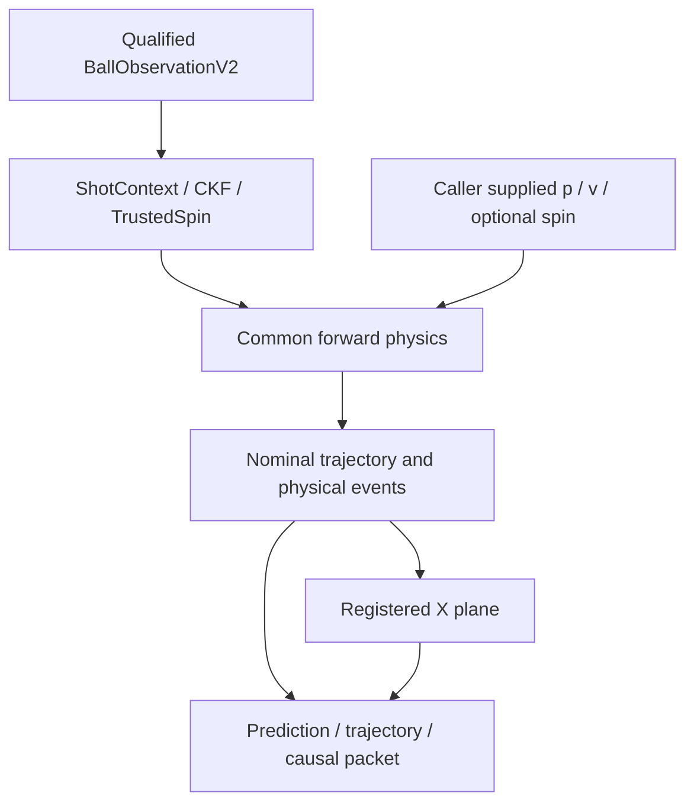

# Add isolated V2 ball-flight forecasting and shared forward physics (no racket planning)

The scoped source branch includes historical PR49 selector/command scaffolding and replacements for deployed physics. This branch selectively ports the physical forecast onto upstream while preserving original production behavior.

Base: `8d599e7d21e196275cf426488555e2648e8fd789` (`hitchopen/HOPE:nightly_built`). Source: `9118a491df658fa7e68f042581af48890ec8b0b8`. Validated code/tests: `38e31927373d90c538984f6174b6ff3525edf35e`; fresh runtime build `4a495ec1e1ba407c6c19bfd95afd8ad04e5859b5`, with unchanged runtime build inputs on the validation head. Branch: `feature/flight-state-prediction-v2-minimal`; following review commits update docs/evidence only.

Six physical interfaces carry source/arrival time, optional qualified spin, conditional uncertainty and checkpoint lineage. Observation/context revisions remain 2; forecast/packet revisions are 3. Old schema-2 forecast/packet consumers must reject revision 3. Missing pose withholds the plane event while useful physical forecasts remain available. Outputs retain their exact three shadow channels; command, unregistered-shadow and cross-channel remaps fail.

The 24 old hybrid/strike-selector paths and targets/messages/tests are omitted. Original Stage 2, all five physics modes, Stage 3, batch/spin estimator, scheduler, planner, packetizer, Python code and production YAML retain upstream behavior. Public BallSample grows; rebuild dependent C++ packages. The reusable forward API accepts caller-supplied initial state and chooses no racket action.

Revalidation fixes one V2-only defect: missing observations across a possible bounce cannot support a smooth-acceleration rejection. The regression fails before and passes after, preserving incomplete history and never fabricating contacts. No physical coefficient is tuned.

Validation: clean HOPE-only build; messages 2/2; planner 30/30 groups (36 core / 8 transport native cases, installed API, numerical, causal/matched tooling, source/binary/ROS guards and all eight independent-paced ROS combinations); native sanitizers 13/13. Bringup 24/26 retains exactly the baseline flake8/pep257 file/code issue set; one unsupported standalone replay mode skips on both branches. Exact production parity covers 701 fixtures/samples and preserves distinct Nakashima/venue laws.

At the selected 50 Hz full-output cadence, nominal 150/300 Hz compact coverage is 100.0%/97.99%, receipt P95 1.93/3.21 ms; actual observed rates are 144.89/289.49 Hz. Delayed workers pass. Optional 150 Hz/unrestricted full output at 300 Hz fail coverage and remain unqualified. Thresholds are unchanged.

Physical accuracy remains **NOT_RUN**. Matched scoring/plotting is tested with labelled synthetic data only; historical APIs expose plane targets rather than invented bounce/apex estimates, and comparison currently requires fixed registered x_hit=.15. No physical superiority or deployment readiness is claimed. No robot motion, merge or PR creation is performed by this task. PR #49 is closed/unmerged; its history is not this branch's base. Source branches and nohope remain untouched.

Review `flight_prediction_minimal_scope_manifest.json` (every changed file), `flight_prediction_excluded_pr49_files.md`, `flight_prediction_acceptance.json`, `flight_prediction_production_parity.json` and the engineering report. Reproduce using `flight_prediction_validation.md`; raw logs/XML and synthetic figures are archived separately.
