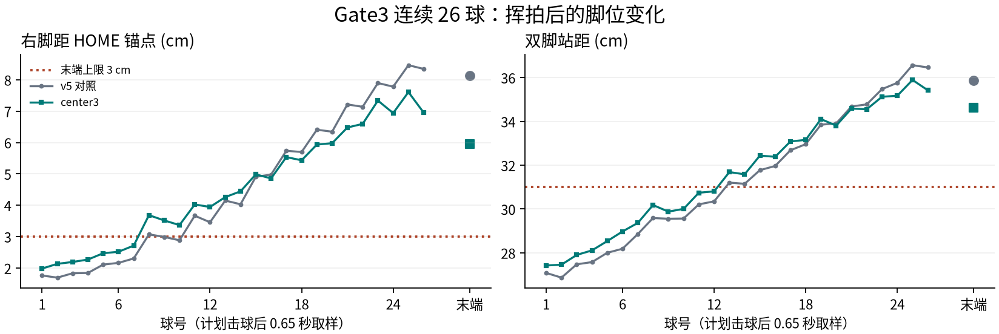

# model400 连续击球与回稳试验

最终仿真候选为 **center3**。资格以 Gate3 的原始结果为准。本轮使用本地原生仿真和历史轨迹重放，现场模型未切换。
正式 Gate3 的 26 球全部合法，末端右脚偏移为 5.96 cm，超过 3 cm。保留为离线候选，尚未达成实机晋级条件。
全新 486 球的合法数为 v5 427、候选 418，发生碰撞的球数分别为 9 和 10。

以 400 v5 作对照，测试了 20 个新模型，涵盖双脚间距与朝向反馈、双脚固定位置反馈、低中高击球点补偿、回位目标修正，以及在挥拍中混入部分待球下肢动作。所有候选使用相同的 Runner、球物理和各自测试组的来球顺序。每段连续来球保留上一球结束时的状态。原始观测与仿真脚位对照中，300 个采样点的足间距绝对差 P95 为 0.31 cm。

## 新生成的 486 球

这组来球按横向位置、速度、高度和角度分层，分六段连续打完。已核对来球初始状态及自旋与开发集和既有验证集无重复。选定候选后才执行此组测试。

|模型|触拍|合法回球|计划误差有效球数|发生右臂或球拍非球碰撞的球数|平均末端脚位偏移 cm|最差末端脚位偏移 cm|
|---|---:|---:|---:|---:|---:|---:|
| v5 | 442/486 | 427/486 | 485 | 9 | 5.45 | 7.26 |
| center3 | 444/486 | 418/486 | 486 | 10 | 6.04 | 7.88 |

批量仿真的脚位偏移取每段热身结束至整段结束时两脚中偏移较大者。正式 Gate3 按自己的 MOTION 前锚点判断。

|新来球组|合法数 v5 → 候选|位置均值 cm|位置方差 cm²|速度均值 m/s|速度方差 (m/s)²|拍面角均值 °|拍面角方差 °²|
|---|---:|---:|---:|---:|---:|---:|---:|
|全部（486 球）|427 → 418|5.397 → 5.267|10.570 → 12.219|0.283 → 0.278|0.035 → 0.045|5.791 → 5.901|46.132 → 41.878|
|正手（232 球）|203 → 199|5.116 → 4.987|7.535 → 9.242|0.287 → 0.286|0.022 → 0.038|6.448 → 7.014|42.385 → 48.887|
|低球（162 球）|154 → 153|4.471 → 4.048|6.004 → 6.072|0.294 → 0.283|0.050 → 0.076|3.477 → 3.688|26.118 → 11.459|
|中球（162 球）|143 → 139|4.944 → 4.668|9.334 → 8.632|0.219 → 0.219|0.019 → 0.024|6.446 → 6.267|62.157 → 49.078|
|高球（162 球）|130 → 126|6.784 → 7.098|13.414 → 16.803|0.335 → 0.334|0.028 → 0.026|7.460 → 7.760|41.539 → 56.721|

所有误差取计划击球时刻，含挥空，有效计划按相同球号配对；方差为总体方差。分组使用预设来球类别。区间按连续测试段整体重采样，详见 tests/fresh/paired.json。

## 既有 486 球回归组

|模型|触拍|合法回球|计划误差有效球数|碰撞球数|平均末端脚位偏移 cm|最差末端脚位偏移 cm|
|---|---:|---:|---:|---:|---:|---:|
| v5 | 448/486 | 425/486 | 486 | 9 | 5.18 | 6.10 |
| center3 | 450/486 | 428/486 | 486 | 13 | 5.45 | 6.83 |

## 正式 Gate3 与现场记录重放

|模型|Gate3 合法回球|跌倒|右脚末端偏移 cm|末端站距 cm|末端右脚倾角 °|达成回稳的球数|证书|
|---|---:|---:|---:|---:|---:|---:|---|
|v5|26/26|0|8.12|35.87|0.05|6|FAIL|
|width3|26/26|0|8.07|33.25|10.72|7|FAIL|
|center3|26/26|0|5.96|34.62|6.67|8|FAIL|

右脚末端偏移限值 3 cm，站距范围 26–31 cm，末端脚倾角上限 5°。v5 使用上轮相同模型、场景与 Runner 哈希的存档对照。原始报告仍有 wire ID 与本地球号的兼容问题；gate 目录附有独立的逐球完成事件核对。

52 条现场记录从实测初态重放，v5 与 center3 的模拟触拍分别为 43/52、45/52；其中正手分别为 12/16、13/16。重放在每条记录的初态开始，现场真实命中率仍需实机对照。

offline-candidate 目录保存该实验模型的 ONNX 和匹配配置。selected-hashes.json 记录冻结的文件身份。

